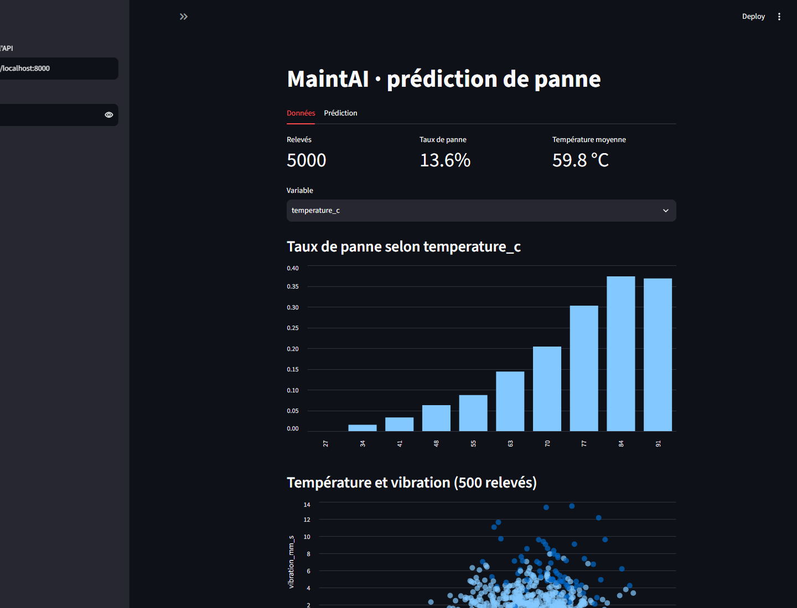

# Compte rendu · TP4 : MaintAI devient un package Python

**Groupe :** 5IA G2 · **Membre :** Younes Radouani · **Date :** 10 novembre 2026

**Travail individuel (en monôme).**

Consignes suivies : `S6_polycopie.pdf`, partie « TP4 · Un package Python pour MaintAI » (pages imprimées 7–8), et modèle `COMPTE_RENDU.md` du starter.

## 1. Mise en place (environnement propre au TP4)

Le répertoire de travail vérifié est `C:\Users\Othmane\Desktop\maintai-starter-tp4` ; sa racine contient `pyproject.toml`. Toutes les sources sont modifiées dans ce dossier. L'environnement utilisé est son propre `.venv`, avec Python 3.13.14. Aucun environnement ni serveur du TP3 n'a été modifié. L'essai de distribution utilise uniquement le dossier temporaire extérieur demandé au sprint 2.

La copie de rendu préparée dans `TP/TP4` est destinée au futur dépôt. Les chemins absolus ci-dessous désignent l'emplacement réel des expériences locales.

Commandes PowerShell exécutées (les exécutables explicites du venv évitent toute confusion avec le TP3) :

```powershell
Get-Location
Test-Path pyproject.toml
python -m venv .venv
.\.venv\Scripts\python.exe -m pip install -r requirements.txt
.\.venv\Scripts\python.exe -m maintai.dataset
.\.venv\Scripts\python.exe -m maintai.train
.\.venv\Scripts\python.exe -m pytest
```

La création initiale du venv a rencontré un `PermissionError` dans les dossiers temporaires du bac à sable Windows. La même opération avec les accès nécessaires a abouti, sans utiliser le venv du TP3. L'installation complète est conservée dans [01-installation.txt](docs/preuves/01-installation.txt). PowerShell ajoute un habillage `NativeCommandError` aux notices écrites sur stderr par pip ; le journal contient bien `Successfully installed` et `pip check` ne signale aucune dépendance cassée.

Données réellement générées :

```text
$ .venv\Scripts\python.exe -m maintai.dataset
5000 relevés écrits dans C:\Users\Othmane\Desktop\maintai-starter-tp4\data\sensors.csv (taux de panne : 13.6%)

Code de sortie : 0
```

Entraînement réel :

```text
$ .venv\Scripts\python.exe -m maintai.train
{

  "model": {

    "accuracy": 0.904,

    "recall": 0.75,

    "precision": 0.622,

    "threshold": 0.3

  },

  "baseline": {

    "accuracy": 0.864,

    "recall": 0.0

  },

  "n_train": 4000,

  "n_test": 1000

}

Modèle sauvegardé dans C:\Users\Othmane\Desktop\maintai-starter-tp4\models\model.joblib

Code de sortie : 0
```

Dernière ligne de `python -m pytest` avant installation du package :

```text
2 failed, 25 passed, 1 warning in 19.28s
```

Les échecs sont `tests/test_package.py::test_installed_version_matches_the_code` et `tests/test_package.py::test_command_is_declared`. Le premier cherche les métadonnées de distribution via `importlib.metadata.version("maintai")`, absentes avant installation. Le second cherche `maintai-predict` dans les points d'entrée installés. Importer les sources depuis la racine ne crée ni ces métadonnées ni cette commande. Les 27 tests fournis sont conservés sans modification. [Sortie initiale complète](docs/preuves/04-tests-avant.txt).

## 2. Sprint 1 : `pyproject.toml` et `pip install -e .`

Sections complétées :

```toml
dependencies = [
    "numpy>=2.2",
    "pandas>=2.2",
    "scikit-learn>=1.6",
    "joblib>=1.4",
    "httpx>=0.28",
]

[project.scripts]
maintai-predict = "maintai.cli:main"
```

Ces bibliothèques sont importées par la génération, les données, l'entraînement, la prédiction et le client HTTP de `maintai/`. `pytest` et `ruff` servent au développement et restent dans `dev`. `fastapi` et `uvicorn` sont nécessaires à l'API optionnelle (`api`), et `streamlit` à l'interface optionnelle (`ui`). Ils ne sont pas requis pour utiliser la commande de prédiction locale.

```powershell
.\.venv\Scripts\python.exe -m pip install -e .
.\.venv\Scripts\python.exe -m pip show maintai
.\.venv\Scripts\maintai-predict.exe 72 6 85 15000
```

Quatre premières lignes utiles de `pip show maintai` :

```text
Name: maintai
Version: 0.2.0
Summary: Prédiction de panne à partir de relevés de capteurs industriels.
Home-page:
```

La sortie complète indique `Editable project location: C:\Users\Othmane\Desktop\maintai-starter-tp4`. [Installation éditable](docs/preuves/05-editable.txt), [pip show](docs/preuves/06-pip-show.txt).

Prédiction depuis le TP4 :

```text
$ .venv\Scripts\maintai-predict.exe 72 6 85 15000
Probabilité de panne : 95 % (ALERTE)

Code de sortie : 0
```

Depuis le dossier extérieur `C:\Users\Othmane\AppData\Local\Temp\maintai-tp4-essai-c79vgyf9` :

```text
Dossier : C:\Users\Othmane\AppData\Local\Temp\maintai-tp4-essai-c79vgyf9
$ C:\Users\Othmane\Desktop\maintai-starter-tp4\.venv\Scripts\maintai-predict.exe 72 6 85 15000
Probabilité de panne : 95 % (ALERTE)

Code de sortie : 0
```

```text
Dossier : C:\Users\Othmane\AppData\Local\Temp\maintai-tp4-essai-c79vgyf9
$ C:\Users\Othmane\Desktop\maintai-starter-tp4\.venv\Scripts\python.exe -c "import maintai; print(maintai.__file__)"
C:\Users\Othmane\Desktop\maintai-starter-tp4\maintai\__init__.py

Code de sortie : 0
```

Python trouve toujours le code dans le dossier source du TP4 : l'installation éditable enregistre un mécanisme d'import vers cette source dans le `site-packages` du venv. Le répertoire courant n'a donc plus besoin de contenir `maintai/`.

Expérience : remplacement temporaire du préfixe du message dans `maintai/cli.py`, sans nouvelle installation :

```text
Dossier : C:\Users\Othmane\AppData\Local\Temp\maintai-tp4-essai-c79vgyf9
$ C:\Users\Othmane\Desktop\maintai-starter-tp4\.venv\Scripts\maintai-predict.exe 72 6 85 15000
TEST ÉDITABLE — Probabilité de panne : 95 % (ALERTE)

Code de sortie : 0
```

Le changement est visible immédiatement parce que la commande importe la source éditable. Le fichier original a été restauré octet pour octet, puis la commande relancée :

```text
Dossier : C:\Users\Othmane\AppData\Local\Temp\maintai-tp4-essai-c79vgyf9
$ C:\Users\Othmane\Desktop\maintai-starter-tp4\.venv\Scripts\maintai-predict.exe 72 6 85 15000
Probabilité de panne : 95 % (ALERTE)

Code de sortie : 0
```

Lancement direct de Streamlit, sans `python -m` :

```text
Commande : .venv\Scripts\streamlit.exe run ui/app.py --server.port 8502 --server.headless true --browser.gatherUsageStats false
URL : http://localhost:8502/_stcore/health
HTTP 200
ok
```

Le port `8502` isole le TP4 des serveurs TP3. Le navigateur a effectivement exécuté la page et affiché 5000 relevés, un taux de panne de 13,6 % et une température moyenne de 59,8 °C. Aucune prédiction n'a été envoyée à une API TP3. Les tests UI fournis vérifient aussi l'affichage avec leurs propres données et un client simulé.



Résultat après installation :

```text
27 passed, 1 warning in 6.19s
```

Résultat final, après restauration du message CLI :

```text
27 passed, 1 warning in 12.50s
```

[Tests après installation](docs/preuves/10-tests-apres.txt), [tests finaux complets](docs/preuves/22-tests-finaux.txt). L'avertissement supplémentaire par rapport au résumé attendu est `StarletteDeprecationWarning: Using httpx with starlette.testclient is deprecated; install httpx2 instead.` Il provient des dépendances FastAPI/Starlette fournies. Aucun test n'a été supprimé ou adapté pour le masquer.

## 3. Sprint 2 : construire et installer le wheel

```powershell
.\.venv\Scripts\python.exe -m build
Get-ChildItem dist
tar -tf dist\maintai-0.2.0-py3-none-any.whl
```

`python -m build` a réussi et produit le sdist et le wheel. [Journal complet](docs/preuves/11-build.txt).

Sortie de `dir dist` :

```text
Name                           Length
----                           ------
maintai-0.2.0-py3-none-any.whl  11623
maintai-0.2.0.tar.gz            12221
```

Contenu réel du wheel :

```text
$ tar -tf dist\maintai-0.2.0-py3-none-any.whl
maintai/__init__.py

maintai/cli.py

maintai/client.py

maintai/config.py

maintai/data.py

maintai/dataset.py

maintai/predict.py

maintai/train.py

maintai/api/__init__.py

maintai/api/main.py

maintai/api/schemas.py

maintai/api/security.py

maintai-0.2.0.dist-info/METADATA

maintai-0.2.0.dist-info/WHEEL

maintai-0.2.0.dist-info/entry_points.txt

maintai-0.2.0.dist-info/top_level.txt

maintai-0.2.0.dist-info/RECORD

Code de sortie : 0
```

Le modèle, les données, les tests et `ui/` sont absents du wheel. `[tool.setuptools.packages.find] include = ["maintai*"]` limite la découverte aux packages `maintai`. Les métadonnées de distribution ajoutent notamment les dépendances et le point d'entrée. Le sdist peut inclure les tests ; son contenu n'est pas celui du wheel.

Une première lecture du wheel depuis le bac à sable a été refusée par les permissions Windows ; la lecture `tar -tf` avec les accès du build a ensuite réussi. Ce refus ne venait pas d'un wheel invalide.

L'environnement neuf est `C:\Users\Othmane\AppData\Local\Temp\maintai-tp4-essai-c79vgyf9\.venv`, hors des deux TP, créé sans `--system-site-packages`. Il ne reçoit pas `requirements.txt` au départ : il installe seulement le wheel et ses dépendances déclarées.

```powershell
cd "C:\Users\Othmane\AppData\Local\Temp\maintai-tp4-essai-c79vgyf9"
& "C:\Users\Othmane\Desktop\maintai-starter-tp4\.venv\Scripts\python.exe" -m venv .venv
.\.venv\Scripts\python.exe -m pip install "C:\Users\Othmane\Desktop\maintai-starter-tp4\dist\maintai-0.2.0-py3-none-any.whl"
.\.venv\Scripts\maintai-predict.exe 72 6 85 15000
$env:MAINTAI_MODELS_DIR = 'C:\Users\Othmane\Desktop\maintai-starter-tp4\models'
.\.venv\Scripts\maintai-predict.exe 72 6 85 15000
.\.venv\Scripts\python.exe -m pip install scikit-learn==1.8.0
.\.venv\Scripts\maintai-predict.exe 72 6 85 15000
```

| Étape | Résultat réellement observé |
|---|---|
| Sans `MAINTAI_MODELS_DIR` | Modèle introuvable sous le `site-packages/models` du nouvel environnement ; code de sortie 1. |
| Avec `MAINTAI_MODELS_DIR` vers les modèles TP4 | Voir sortie exacte ci-dessous : avertissements de version et prédiction. |
| Après installation de `scikit-learn==1.8.0` | Prédiction `95 % (ALERTE)`, sans avertissement de version ; code de sortie 0. |

Premier lancement :

```text
Dossier : C:\Users\Othmane\AppData\Local\Temp\maintai-tp4-essai-c79vgyf9
$ C:\Users\Othmane\AppData\Local\Temp\maintai-tp4-essai-c79vgyf9\.venv\Scripts\maintai-predict.exe 72 6 85 15000
Modèle introuvable : C:\Users\Othmane\AppData\Local\Temp\maintai-tp4-essai-c79vgyf9\.venv\Lib\site-packages\models\model.joblib
Entraînez-le (python -m maintai.train) ou indiquez son dossier dans MAINTAI_MODELS_DIR.

Code de sortie : 1
```

Après configuration du dossier des modèles :

```text
Dossier : C:\Users\Othmane\AppData\Local\Temp\maintai-tp4-essai-c79vgyf9
$ C:\Users\Othmane\AppData\Local\Temp\maintai-tp4-essai-c79vgyf9\.venv\Scripts\maintai-predict.exe 72 6 85 15000
C:\Users\Othmane\AppData\Local\Temp\maintai-tp4-essai-c79vgyf9\.venv\Lib\site-packages\sklearn\base.py:525: InconsistentVersionWarning: Trying to unpickle estimator StandardScaler from version 1.8.0 when using version 1.9.1. This might lead to breaking code or invalid results. Use at your own risk. For more info please refer to:
https://scikit-learn.org/stable/model_persistence.html#security-maintainability-limitations
  warnings.warn(
C:\Users\Othmane\AppData\Local\Temp\maintai-tp4-essai-c79vgyf9\.venv\Lib\site-packages\sklearn\base.py:525: InconsistentVersionWarning: Trying to unpickle estimator LogisticRegression from version 1.8.0 when using version 1.9.1. This might lead to breaking code or invalid results. Use at your own risk. For more info please refer to:
https://scikit-learn.org/stable/model_persistence.html#security-maintainability-limitations
  warnings.warn(
C:\Users\Othmane\AppData\Local\Temp\maintai-tp4-essai-c79vgyf9\.venv\Lib\site-packages\sklearn\base.py:525: InconsistentVersionWarning: Trying to unpickle estimator Pipeline from version 1.8.0 when using version 1.9.1. This might lead to breaking code or invalid results. Use at your own risk. For more info please refer to:
https://scikit-learn.org/stable/model_persistence.html#security-maintainability-limitations
  warnings.warn(
Probabilité de panne : 95 % (ALERTE)

Code de sortie : 0
```

Version installée automatiquement avant alignement :

```text
Dossier : C:\Users\Othmane\AppData\Local\Temp\maintai-tp4-essai-c79vgyf9
$ C:\Users\Othmane\AppData\Local\Temp\maintai-tp4-essai-c79vgyf9\.venv\Scripts\python.exe -c "import sklearn; print(sklearn.__version__)"
1.9.1

Code de sortie : 0
```

Après installation de la version indiquée dans `requirements.txt` :

```text
Dossier : C:\Users\Othmane\AppData\Local\Temp\maintai-tp4-essai-c79vgyf9
$ C:\Users\Othmane\AppData\Local\Temp\maintai-tp4-essai-c79vgyf9\.venv\Scripts\maintai-predict.exe 72 6 85 15000
Probabilité de panne : 95 % (ALERTE)

Code de sortie : 0
```

Origine de l'import dans l'environnement neuf et contrôle des dépendances :

```text
Dossier : C:\Users\Othmane\AppData\Local\Temp\maintai-tp4-essai-c79vgyf9
$ C:\Users\Othmane\AppData\Local\Temp\maintai-tp4-essai-c79vgyf9\.venv\Scripts\python.exe -c "import maintai, sklearn; print(maintai.__file__); print(sklearn.__version__)"
C:\Users\Othmane\AppData\Local\Temp\maintai-tp4-essai-c79vgyf9\.venv\Lib\site-packages\maintai\__init__.py
1.8.0

Code de sortie : 0
```

```text
Dossier : C:\Users\Othmane\AppData\Local\Temp\maintai-tp4-essai-c79vgyf9
$ C:\Users\Othmane\AppData\Local\Temp\maintai-tp4-essai-c79vgyf9\.venv\Scripts\python.exe -m pip check
No broken requirements found.

Code de sortie : 0
```

`InconsistentVersionWarning` vient du chargement d'objets scikit-learn sérialisés avec une autre version. Le wheel autorise `scikit-learn>=1.6` : pip a donc choisi une version plus récente que celle de l'entraînement. La ligne `"sklearn_version": "1.8.0"` explique l'avertissement dans `models/model_info.json` :

```json
{
  "features": [
    "temperature_c",
    "vibration_mm_s",
    "load_pct",
    "runtime_hours"
  ],
  "target": "failure",
  "threshold": 0.3,
  "trained_at": "2026-11-10T17:48:26Z",
  "sklearn_version": "1.8.0"
}
```

Installer la version exacte de l'entraînement fait disparaître ces avertissements. La réussite d'une prédiction malgré un avertissement ne garantit pas la compatibilité générale des modèles sérialisés. Pour livrer ce modèle, il faut le wheel, les fichiers `models/` séparés et les versions d'entraînement. [Installation du wheel](docs/preuves/14-install-wheel.txt), [alignement scikit-learn](docs/preuves/18-install-sklearn.txt).

## 4. Questions de compréhension

1. **`requirements.txt` et `dependencies` :** le premier fige avec `==` les versions directes de l'environnement du TP et de l'entraînement, y compris tests, API, UI et outil de build. Il ne verrouille pas toutes les dépendances transitives. `dependencies` décrit avec des bornes minimales les besoins d'exécution du package et est embarqué dans le wheel ; pip les résout lors de son installation. Les fonctionnalités optionnelles restent dans les extras.
2. **Installation éditable et wheel :** `pip install -e .` relie les imports aux sources locales ; leurs modifications sont visibles sans réinstallation. Installer le wheel copie une distribution construite dans `site-packages`, indépendante du dossier source. Modifier ensuite le starter ne change pas le package installé depuis le wheel ; il faut reconstruire et réinstaller la distribution.
3. **Point d'entrée :** `[project.scripts]` associe un nom de commande à une fonction Python (`maintai.cli:main`). pip crée sous Windows le lanceur `.venv\Scripts\maintai-predict.exe`. Après activation du venv, `Scripts` est dans `PATH` ; ici son chemin explicite garantit l'utilisation du bon environnement. Le lanceur appelle `main()` et utilise son résultat comme code de sortie.

## 5. Le rendu Git

- **Lien de pull request :** en attente du lien du dépôt ; aucune publication effectuée.
- **Tag `tp4` sur GitHub :** à créer après fusion ; non créé pendant ce travail local.
- **`git status` avant commit :** non disponible : le starter n'a pas de `.git` et `git` n'est pas dans le `PATH`. Aucune sortie de `git status` n'est inventée.
- Le dossier `TP/TP4` préparé localement contient uniquement les sources, les tests fournis, les documents et preuves. Son `.gitignore` exclut `.env`, `.venv/`, `data/*.csv`, `models/`, les caches, `dist/`, `build/` et `*.egg-info/`.
- Les données, modèles et distributions restent dans le dossier de travail pour reproduire les essais, hors du dossier de rendu. Le wheel reste à `C:\Users\Othmane\Desktop\maintai-starter-tp4\dist\maintai-0.2.0-py3-none-any.whl`.

Quand le dépôt sera connu : créer une branche `tp4`, copier ce dossier préparé dans `TP/TP4` du dépôt, vérifier `git status` et `git diff --cached`, committer et pousser la branche, ouvrir une pull request, effectuer la relecture, fusionner, puis créer et pousser le tag `tp4` sur le commit fusionné. Les autres TP du dépôt doivent rester intacts.

## 6. Ce qui reste flou

Les objectifs locaux sont vérifiés : installation éditable, commande depuis un autre dossier, effet immédiat d'une modification, lancement direct de Streamlit, construction du wheel et prédiction depuis un environnement neuf. La distinction à retenir est que distribuer le code ne distribue ni le modèle entraîné ni automatiquement ses versions exactes. Seules les opérations GitHub attendent le dépôt.
